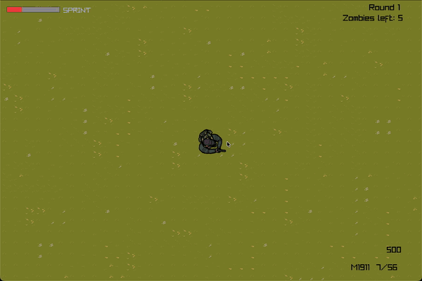
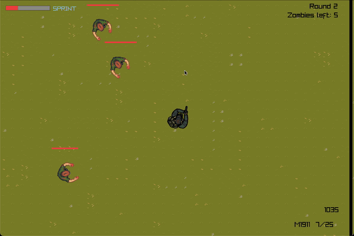
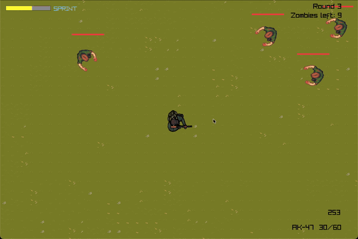

# Z-Target

**A top-down zombie survival shooter. How many rounds can you last?**

## About the game

You're alone in a walled arena, and the dead keep coming.

Every round sends a bigger, tougher and faster horde your way. Shoot, slash and sprint to stay alive, earn points for every hit, and spend them on the **Mystery Box** to get a better weapon. Survive the round, catch your breath for a few seconds… and get ready for the next one.

Inspired by the classic *Call of Duty: Zombies* mode.

## Features

- **Endless rounds**: each round brings more zombies, with more health and more speed.
- **15 weapons**: pistols, SMGs, assault rifles, shotguns, a sniper and the legendary Ray Gun.
- **The Mystery Box**: pay 950 points to roll a random weapon. Take it or leave it!
- **Power-ups**: killed zombies sometimes drop a bonus:

| | Power-up | Effect |
|:---:|---|---|
|  | **Max Ammo** | Refills the ammo of both your weapons |
|  | **Insta-Kill** | Every shot kills, for 10 seconds |
|  | **Double Points** | Every hit is worth twice the points, for 10 seconds |
|  | **Nuke** | Wipes out every zombie on the map |

- **Knife attack** for when the horde gets too close.
- **Sprint** to escape, but watch your stamina.
- **Health regeneration**: take three hits and you're dead, but stay out of trouble for a moment and you'll recover.

## Controls

| Action | Key |
|---|---|
| Move | **W A S D** (Z Q S D on an AZERTY keyboard) |
| Aim | Mouse |
| Shoot | Left click |
| Reload | **R** |
| Switch weapon | **E** |
| Knife | **V** |
| Sprint | **Shift** |
| Use the Mystery Box / take the weapon | **F** |
| Play again (after a game over) | **R** |
| Quit | **Esc** |

## Tips

- Points come from **every hit**, not just kills: weaker weapons can earn you more points per zombie.
- Don't stand still: the horde surrounds you fast.
- Keep the Nuke for when you're cornered… if you can.

## Credits

Sprites by Riley Gombart, Cainos and Serial. See [CREDITS.md](CREDITS.md) for the full list.
